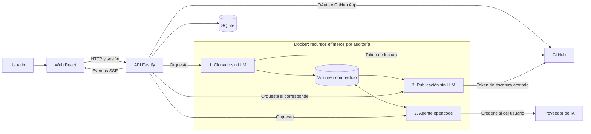
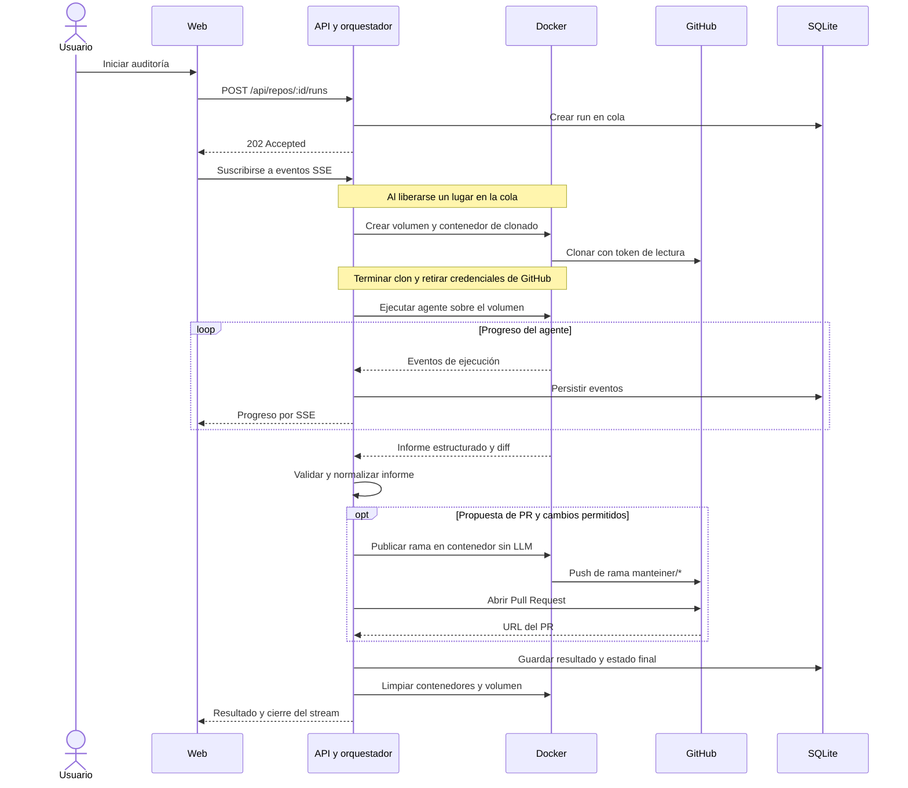

# Manteiner

**De un repositorio con deuda de mantenimiento a un informe accionable y un Pull Request revisable.**

Manteiner conecta repositorios de GitHub y ejecuta agentes de IA de mantenimiento en
contenedores efímeros de Docker. Permite seguir la auditoría en tiempo real, consultar sus
hallazgos e histórico y publicar actualizaciones de dependencias en una rama separada.
El usuario conserva la decisión final: **la aplicación no hace merge de los PRs**.

> **Estado: proyecto en desarrollo, orientado a uso personal/local.** El flujo principal está
> implementado; quedan validaciones integrales y trabajo de seguridad antes de ofrecerlo como
> servicio público. La exportación a PDF todavía no está implementada.

[Funcionalidades](#funcionalidades) · [Arquitectura](#arquitectura) ·
[Instalación](#instalación-local) · [Seguridad](#seguridad-y-limitaciones) ·
[Roadmap](#estado-y-roadmap) · [Documentación](#documentación)

## El problema

Las dependencias desactualizadas, los runtimes fuera de soporte y la deuda técnica se acumulan
cuando el mantenimiento depende de revisiones manuales esporádicas. Manteiner reúne el análisis,
las recomendaciones y la propuesta de cambios en un flujo trazable, sin delegar al agente el
control de las credenciales de escritura de GitHub.

## Funcionalidades

- **Conexión con GitHub:** login OAuth, instalación de GitHub App y selección de repositorios.
- **Tu proveedor de IA:** OpenAI con cuenta ChatGPT mediante device flow, o proveedores con
API key compatibles con el runtime; catálogo y selección de modelo global o por repositorio.
- **Auditorías aisladas:** clon y ejecución en un volumen efímero de Docker, con límites de
recursos, timeouts y limpieza al finalizar.
- **Progreso en vivo:** eventos SSE persistidos, replay y reconexión desde la interfaz.
- **Informes estructurados:** JSON validado, hallazgos, recomendaciones, diff e histórico por repo.
- **PRs revisables:** publicación de archivos permitidos en ramas `manteiner/*`, sin push a la
rama por defecto ni merge automático.
El agente aplica patches/minors compatibles aunque el repo no tenga tests o CI; las
limitaciones de validación se informan en el PR. Los breaking changes se difieren.
- **Controles operativos:** credenciales cifradas, redacción de secretos, rate limiting y cola
de auditorías con concurrencia acotada.

Las funcionalidades implementadas no equivalen a una versión estable: ver las
[validaciones pendientes](#estado-y-roadmap).

## Stack


| Capa                 | Tecnologías                                            |
| -------------------- | ------------------------------------------------------ |
| Frontend             | React, TypeScript, Vite, Tailwind CSS                  |
| API                  | Node.js, Fastify, Better Auth                          |
| Persistencia         | SQLite, Drizzle ORM                                    |
| Contratos            | Zod y JSON Schema                                      |
| Ejecución de agentes | Docker, Dockerode, opencode, runner TypeScript con Bun |
| Integración          | GitHub OAuth, GitHub App, SSE                          |


## Arquitectura

La API administra identidad, credenciales y el ciclo de vida de cada auditoría.
El código auditado se clona en un volumen de Docker, no en un directorio de la aplicación.



### Ciclo de una auditoría

Los tres contenedores se ejecutan **secuencialmente** sobre el mismo volumen. El agente recibe
la credencial del proveedor de IA, pero **no recibe el token de GitHub**. La publicación ocurre
después, en otro contenedor y con controles de la aplicación.



El diagrama resume el camino exitoso; también se intenta limpiar recursos ante fallos y al
arrancar la API se recuperan recursos huérfanos. Un fallo al publicar puede conservar la auditoría
y registrar su motivo. Un destino de push inválido, en cambio, detiene el run.

### Decisiones de ingeniería

- **Separación de privilegios:** el LLM no comparte contenedor con los tokens de GitHub.
- **Contrato compartido:** `packages/contracts` define el informe con Zod y deriva el JSON Schema
y los tipos; la validación no depende de extraer JSON desde prosa.
- **Normalización no destructiva:** las inconsistencias corregibles generan advertencias en
lugar de descartar toda la auditoría.
- **Eventos persistidos antes de emitirse:** la UI puede recuperar progreso tras reconectarse.
- **Un solo proceso:** SQLite, cola y rate limits en memoria simplifican el uso local;
no se presenta como una arquitectura distribuida.

Las alternativas y sus motivos están documentados en
[arquitectura](./docs/01-arquitectura.md) y [decisiones](./docs/12-decisiones-abiertas.md).

## Instalación local

### Requisitos

- **Node.js 22.12 o superior** y npm.
- **Docker** con el daemon activo; Docker Desktop en Windows.
- Una **GitHub OAuth App** para login y una **GitHub App** para acceso a repositorios.
- Una credencial de un proveedor de IA compatible. El uso puede generar costos o consumir
la cuota de tu suscripción.

### 1. Obtener el proyecto

La rama de integración actual es `dev`.

```bash
git clone --branch dev https://github.com/aleledesma/projects-manteiner.git
cd projects-manteiner
npm ci
cp .env.example .env
```

En PowerShell podés usar `Copy-Item .env.example .env` para copiar la configuración.

### 2. Configurar credenciales

Completá `.env` siguiendo [`.env.example`](./.env.example). Generá **dos valores independientes**,
uno para `MASTER_KEY` y otro para `SESSION_SECRET`, ejecutando este comando una vez por secreto:

```bash
node -e "console.log(require('crypto').randomBytes(32).toString('base64'))"
```


| Integración                 | Configuración local                                                       |
| --------------------------- | ------------------------------------------------------------------------- |
| GitHub OAuth App            | Callback: `http://localhost:3001/api/auth/callback/github`                |
| GitHub App                  | Setup URL: `http://localhost:3001/api/github/setup`                       |
| GitHub App: repositorios    | `metadata: read`, `contents: read & write`, `pull requests: read & write` |
| GitHub App: organizaciones  | `members: read` para verificar administración de instalaciones            |
| Clave privada de GitHub App | PEM codificado en base64 en `GITHUB_APP_PRIVATE_KEY_BASE64`               |


El [detalle de autenticación y permisos](./docs/03-autenticacion-github.md) explica por qué hay
dos integraciones. Los webhooks no son necesarios: la sincronización es on-demand.
Las credenciales de IA se conectan desde la interfaz.

**No subas `.env`, claves privadas, bases de datos ni salidas de los spikes.** La API valida
la configuración al arrancar y rechaza secretos obligatorios ausentes o inválidos.

### 3. Construir las imágenes

```bash
npm run docker:build:git
npm run docker:build:agent
```

### 4. Iniciar API y web

En dos terminales, desde la raíz del repositorio:

```bash
# Terminal 1: API
npm run dev
```

```bash
# Terminal 2: frontend
npm run dev:web
```

- Web: [http://localhost:5173](http://localhost:5173)
- API: [http://localhost:3001](http://localhost:3001)
- Healthcheck: [http://localhost:3001/api/health](http://localhost:3001/api/health)

SQLite se inicializa y aplica migraciones al arrancar la API. Docker apagado no impide iniciar
sesión ni administrar repositorios, pero sí ejecutar auditorías.

### 5. Probar el flujo

1. Iniciá sesión con GitHub.
2. Conectá tu proveedor de IA y elegí un modelo.
3. Instalá la GitHub App y vinculá un **repositorio de prueba**.
4. Iniciá una auditoría desde el dashboard y seguí su progreso.
5. Revisá el informe y, si se creó un PR, evaluá sus cambios antes de hacer merge.

## Desarrollo y verificación


| Comando                                                 | Descripción                                  |
| ------------------------------------------------------- | -------------------------------------------- |
| `npm run dev`                                           | API en modo watch                            |
| `npm run dev:web`                                       | Frontend en modo desarrollo                  |
| `npm run typecheck`                                     | Verificación de tipos de los workspaces      |
| `npm test`                                              | Suite de tests de los workspaces             |
| `npm run build`                                         | Build de los workspaces que lo requieren     |
| `npm run docker:build:git`                              | Imagen para clonado y publicación            |
| `npm run docker:build:agent`                            | Imagen del agente y catálogo                 |
| `npm run print-schema --workspace @manteiner/contracts` | JSON Schema del informe                      |
| `npm run db:generate --workspace @manteiner/api`        | Generar migraciones tras modificar el schema |


Usá la misma versión compatible de Node para instalar y ejecutar: `better-sqlite3` incluye un
módulo nativo y debe reinstalarse si cambia la ABI de Node. El estado de la última verificación
y las limitaciones del entorno están en el [handoff](./docs/14-estado-actual.md#estado-de-verificación).
Última verificación local (2026-11-02, Node 24.15.0): **187 tests pasando y typecheck limpio**.
Todavía no hay un pipeline de CI; no se declara un build automatizado como verificado.

## Seguridad y limitaciones

**Publicar este código no equivale a desplegar un servicio seguro para terceros.**

Entre los controles implementados están AES-256-GCM para credenciales en reposo, tokens de
GitHub acotados por repositorio, contenedores no-root con límites de recursos, filtrado de los
archivos a publicar, validación del destino del push y redacción de secretos en logs.

Limitaciones que importan antes de usarlo:

- El agente tiene `bash`, lectura y escritura habilitados, y salida a internet. Docker reduce
exposición, pero **no elimina prompt injection, escape ni exfiltración**. No audites código
sensible sin evaluar estos riesgos.
- El código analizado puede enviarse al proveedor de IA elegido; aplican sus políticas de datos.
- La cola y los rate limits viven en memoria de un único proceso; no son persistentes ni distribuidos.
- Hay verificaciones manuales pendientes y **avisos de vulnerabilidades en dependencias**
detectados el 2026-11-02. Requieren evaluación y actualización antes de exponer una instancia.
- No hay garantía de corrección de las recomendaciones ni de las actualizaciones propuestas.
Revisá siempre el diff y ejecutá los tests del repositorio auditado.

Para un eventual despliegue, web y `/api` deben compartir origen, detrás de HTTPS y un reverse
proxy. Los servidores de desarrollo no son un despliegue de producción.

Consultá el [modelo de amenazas y checklist](./docs/10-seguridad.md) y el
[estado de la revisión](./docs/14-estado-actual.md#revisión-para-publicación-del-repositorio).

## Estado y roadmap


| Área                                          | Estado                                                                             |
| --------------------------------------------- | ---------------------------------------------------------------------------------- |
| Login, GitHub App y repositorios              | Implementado; verificaciones de tamaño y transporte de tokens pendientes           |
| Proveedores de IA, onboarding y configuración | Implementado                                                                       |
| Runner Docker, dashboard, informe e histórico | Implementado                                                                       |
| Progreso SSE y reconexión                     | Implementado; validación integral con run real pendiente                           |
| Publicación de Pull Requests                  | Implementado; validación contra un repositorio real pendiente                      |
| Exportación PDF                               | Pendiente: próxima feature                                                         |
| Endurecimiento                                | Controles automatizables implementados; dependencias y pruebas manuales pendientes |


**Para cerrar v1:** validar el flujo real, resolver avisos de dependencias aplicables,
completar la checklist de seguridad e implementar generación, descarga y regeneración de PDF.
Las auditorías programadas, otros ecosistemas y el escalado multiusuario quedan para después.

Ver el [roadmap detallado](./docs/11-roadmap.md) y el [estado actual](./docs/14-estado-actual.md).

## Estructura del repositorio

```text
apps/
  api/                  API, autenticación, SQLite y orquestación de runs
  web/                  Interfaz React: onboarding, dashboard, informes y settings
packages/
  contracts/            Zod, JSON Schema, normalización y prompts versionados
  agent-runner/         Configuración y arranque del agente en el contenedor
docker/
  git/                  Clonado y publicación, sin LLM
  agent/                Imagen reproducible del runtime del agente
docs/                   Arquitectura, decisiones, seguridad y roadmap
spikes/                 Verificaciones técnicas previas a la implementación
```

## Documentación

- [Índice de documentación](./docs/README.md)
- [Visión y alcance](./docs/00-vision.md)
- [Arquitectura](./docs/01-arquitectura.md)
- [Ejecución en Docker](./docs/05-ejecucion-en-docker.md)
- [Contrato y comportamiento del agente](./docs/06-agente-mantenimiento.md)
- [Seguridad](./docs/10-seguridad.md)
- [Roadmap](./docs/11-roadmap.md)
- [Decisiones y alternativas](./docs/12-decisiones-abiertas.md)